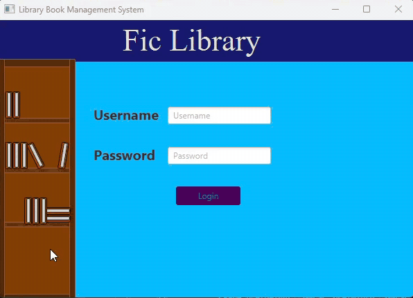
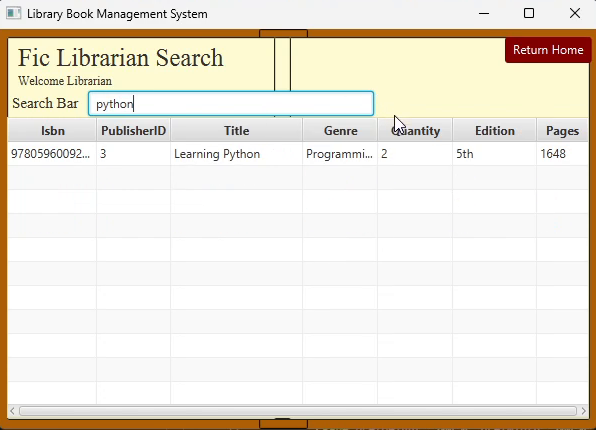
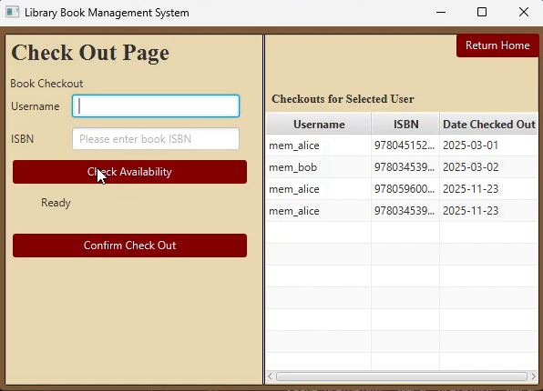
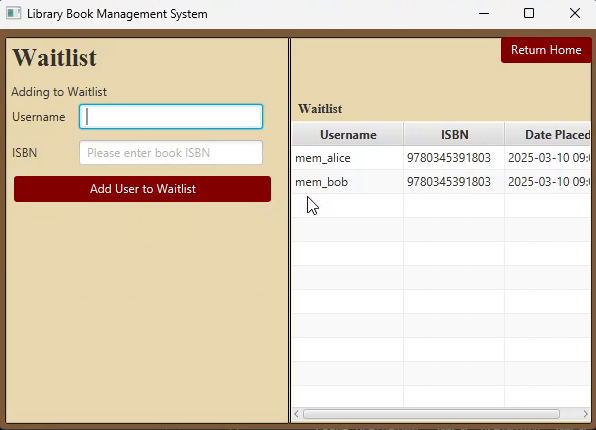
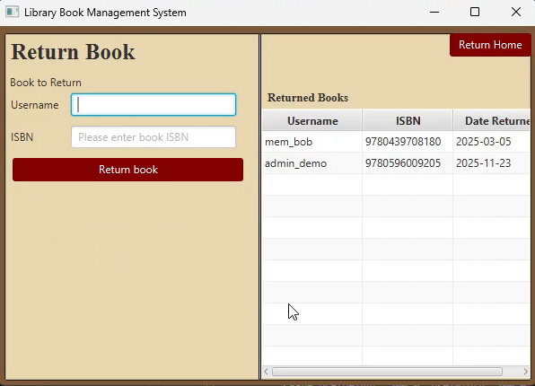
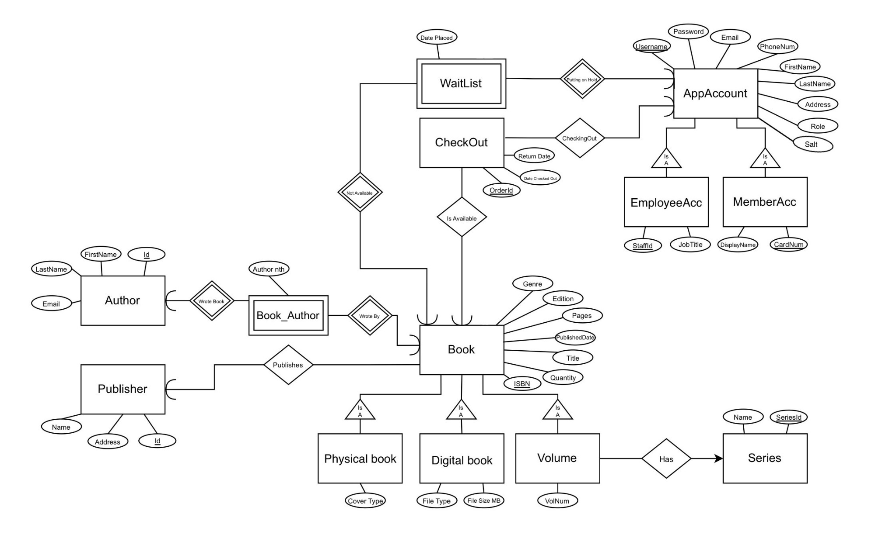

## Demo!! (GIF takes a few seconds to load)

<p align="center">
  
</p>

<p align="center"><em>A quick tour of our JavaFX application!</em></p>

<p align="center"><a href="assets/library-app-walkthrough.mp4">Watch the full 26-second, app-only video</a> OR <a href="#screenshots">Jump to screenshots</a></p>

# Fic Library - Library Book Management System

A desktop application for a small library, built as a **seven-person team project** using **Java, JavaFX, and MySQL**. It gives librarians a place to search books and handle borrowing, returns, and waitlists, while members have a separate catalog-search interface.

The end goal was to connect a graphical interface to a relational database for the app and it worked perfectly! :)

## What it does

- **Log in by role:** Librarian and member accounts open different screens.
- **Find books:** Browse the catalog and filter results by a search term.
- **Check out books:** Look up availability, record a checkout, and view active loans.
- **Handle waitlists:** Add members to a book's waitlist, including when a checkout finds no available copies.
- **Return books:** Record returns and review returned-book history.
- **Store the details:** Connect books, authors, publishers, accounts, loans, and waitlists in MySQL.

> **About the demo:** The video shows navigation and the main screens, plus a catalog search. It doesn't demonstrate every button or a completed checkout/return transaction because I lost the file for that </3 but those do work!

## Screenshots

A quick look around the librarian side of the app. **Click any image to view it at full size.**

| Search the catalog | Checkouts and active loans |
| :---: | :---: |
| <a href="assets/screenshots/catalog-search.png"></a> | <a href="assets/screenshots/checkout.png"></a> |
| Type a keyword to find a book. | Check availability, confirm a loan, and view active checkouts. |
| **Waitlist** | **Returns** |
| <a href="assets/screenshots/waitlist.png"></a> | <a href="assets/screenshots/returns.png"></a> |
| Keep track of who's waiting for a book. | Record returned books and view return history. |

## Database design

The entity-relationship diagram (ERD) shows the design behind the app: **books and their formats**, **authors and publishers**, **library accounts**, **checkouts**, **waitlists**, and **series/volumes**.

<a href="assets/library-database-erd.jpg"></a>

*Click the diagram to see it at full resolution. It documents the conceptual design; see [`db/mysql-ddl.sql`](db/mysql-ddl.sql) for the actual implemented MySQL schema.*

## Built with

| Layer | Technology |
| --- | --- |
| Desktop interface | JavaFX / FXML |
| Application logic | Java 17 |
| Data access | JDBC and Data Access Objects (DAOs) |
| Database | MySQL 8 |
| Build | Maven |
| Database modeling | ERD / relational schema |

The project is organized into `src/main/java/lbms/ui` (screens/controllers), `bo` (business objects), `dao` (database access), and `utils` (shared helpers). SQL setup and sample records are in [`db/`](db/), and additional design notes are in [`docs/`](docs/).

## Run it locally

**You'll need:** JDK 17, Maven, MySQL 8, and a graphical desktop for JavaFX.

1. Clone the repository and open its directory.
2. Start your local MySQL server. From the repo root, initialize the schema and sample data:

   ```bash
   mysql -u root -p < db/mysql-ddl.sql
   mysql -u root -p LBMS < db/views.sql
   mysql -u root -p LBMS < db/seed-data.sql
   ```

   **Heads-up:** `seed-data.sql` clears and reseeds the project's tables. Please use a dedicated development database, NOT one containing anything important!

3. Update the local database username/password in [`DBConnection.java`](src/main/java/lbms/utils/DBConnection.java) if yours aren't `root` / `root`.
4. Build and launch:

   ```bash
   mvn clean compile
   mvn exec:java
   ```

5. Try one of the demo logins created at application startup:

   | Role | Username | Password |
   | --- | --- | --- |
   | Librarian | `admin_demo` | `admin123` |
   | Member | `member_demo` | `member123` |

The app doesn't have a logout button in this version; close and relaunch it to switch demo accounts.

## Team credits

This was a group project, with contributions across backend development, database design, the interface, and documentation!

<details>
<summary>Who worked on what?</summary>

- **Christian McCool:** Project management
- **Erik Barbieri:** Backend (business objects / DAOs) and repository maintenance
- **Elisa Garcia:** Backend (business objects / DAOs)
- **Everette Carrig:** Database design
- **William Henderson:** Database design
- **Brycen Canion:** JavaFX GUI development
- **Brianna Hendrix:** Documentation, QA, testing, and demo preparation

</details>

---

*Little library, lots of moving parts. Happy browsing! :3*
